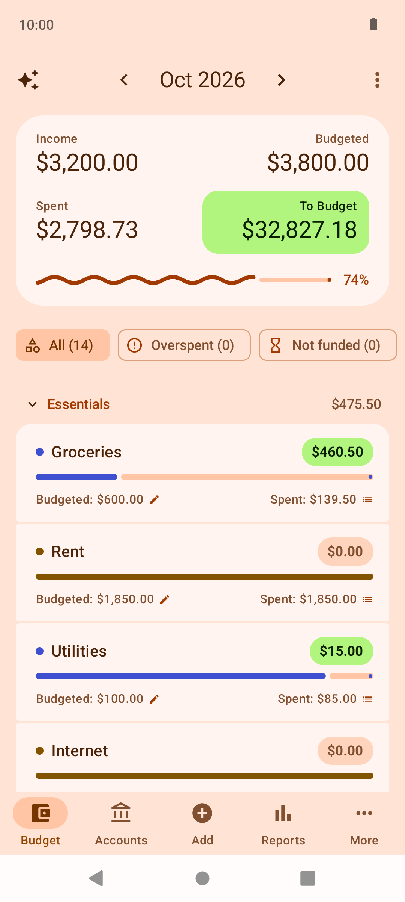
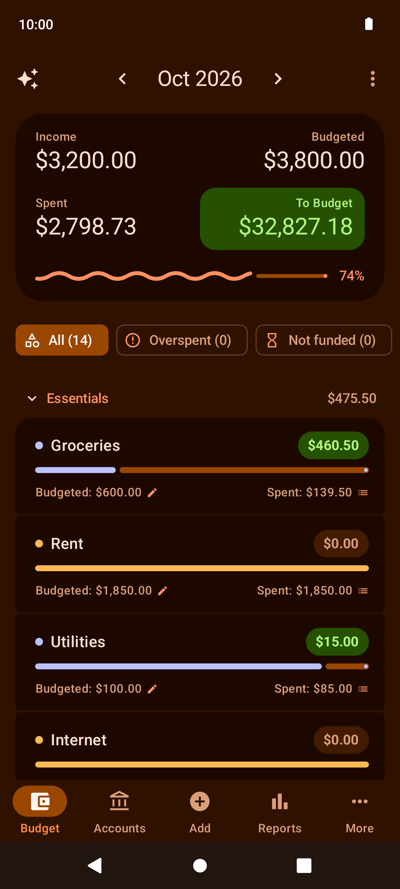
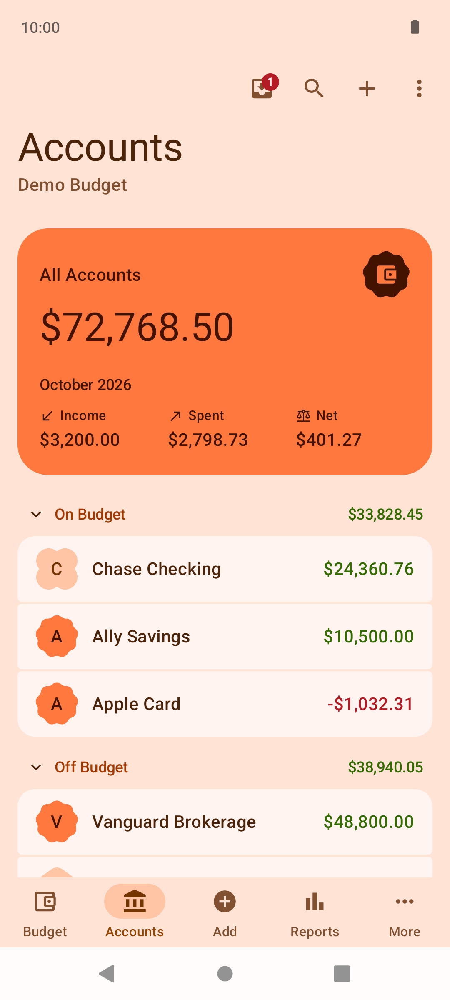
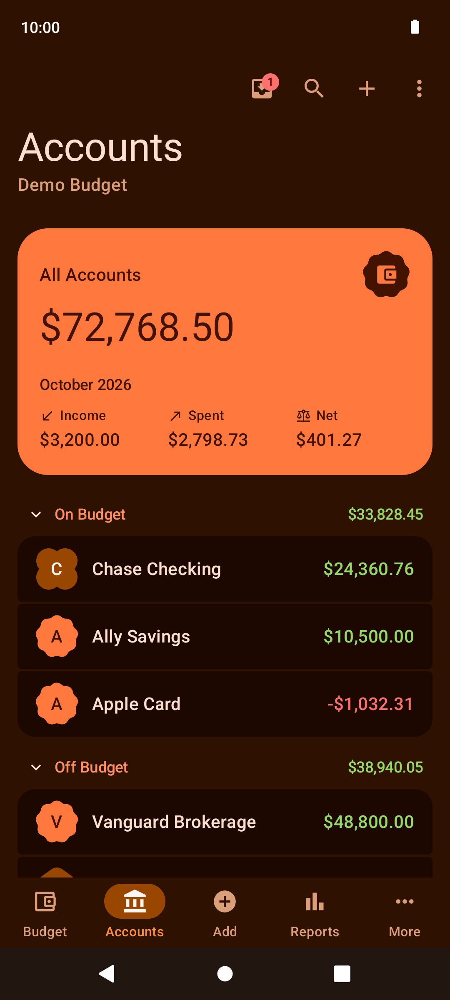
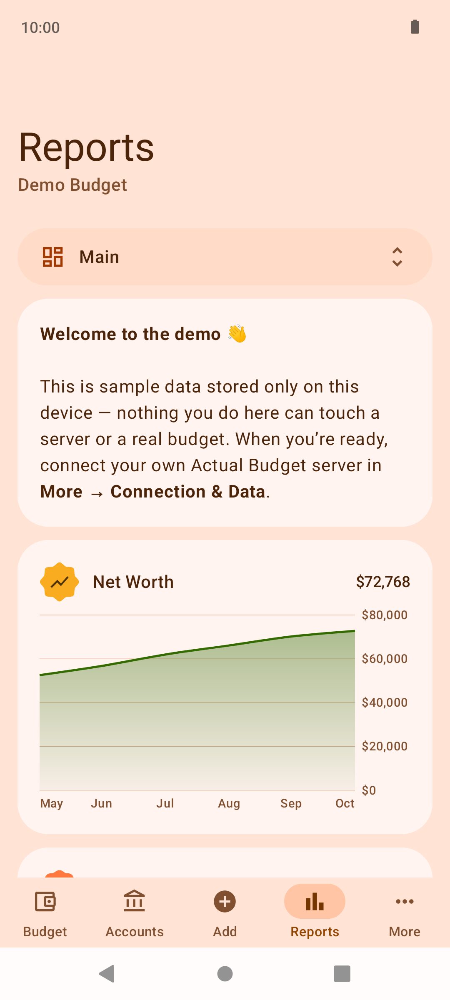
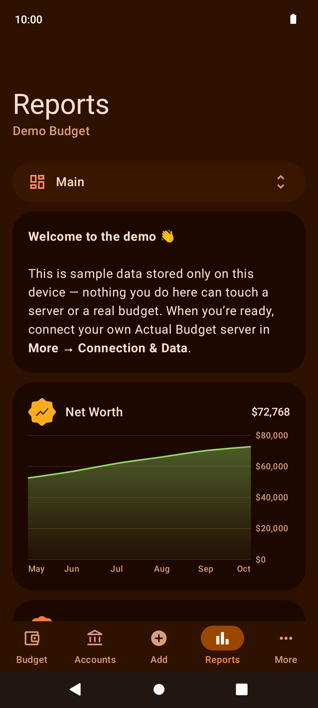
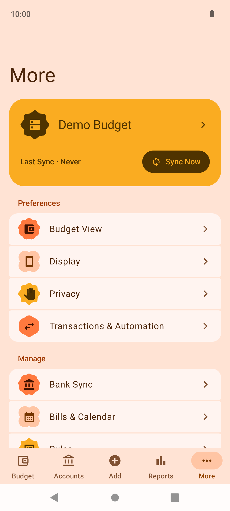
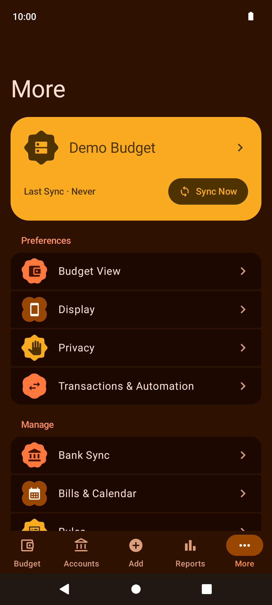

# Actuali for Android

An unofficial Android port of [Actuali](https://github.com/MattFaz/actuali), Matt Farrell's iOS companion app for [Actual Budget](https://actualbudget.org), a local-first, open-source budgeting tool. Built with Kotlin and Jetpack Compose, it brings offline-first budgeting to Android with Material 3 Expressive, a warm orange color scheme, and light and dark themes. Uce can use offline or self-hosted server 

**Unofficial — not affiliated with Actual Budget or the original Actuali author.** Please report Android issues in [this repository](https://github.com/traushb/actuali-android/issues).

## Port and credits

This Android port was made by an AI coding agent, **Claude Code (Claude Opus 5.5 - Max reasoning)** It is based on [Matt Farrell's original MIT-licensed Actuali iOS app](https://github.com/MattFaz/actuali). The CRDT sync engine was ported from the iOS implementation, which in turn derives from [Actual Budget](https://actualbudget.org) and its [open-source project](https://github.com/actualbudget/actual).

The Android application ID is `io.github.traushb.actuali`; it uses a separate identity from the original author's package.

## Screenshots

Captured with the built-in demo budget. All names, balances, and transactions shown are sample data.

| Light | Dark |
| :---: | :---: |
|  |  |
|  |  |
|  |  |
|  |  |

## Features

- Envelope and tracking budgets, with category balances and monthly allocations.
- Accounts and transaction history.
- Add, edit, and split transactions, including transfers.
- Reports dashboard.
- Scheduled transactions and rules.
- Bank sync, with supported providers configured through your Actual server; direct SimpleFIN setup is also available.
- Offline-first local storage and automatic CRDT synchronization with your own Actual Budget server.
- Light and dark mode, Material 3 Expressive, and a warm orange palette.
- A built-in demo budget to try the app without connecting a server.

## Install and build

Requires **Android 8.0 or later (`minSdk 26`)**. The [v1.0 release](https://github.com/traushb/actuali-android/releases/tag/v1.0) contains an APK for testing.

**The release APK is signed with a debug key and is intended for testing.** It is not a production or Play Store distribution. Use a dedicated signing key before distributing a production build; keep signing keys and passwords out of Git.

For development, install Android Studio with support for this project's Android Gradle Plugin, **JDK 21**, and **Android SDK Platform 37**. The Gradle wrapper pins the required Gradle version. Kotlin source targets Java 17; Gradle's daemon uses JDK 21.

Open this repository's root folder in Android Studio, let Gradle sync, and run the `app` configuration. No iOS checkout is needed: translations, the blank budget template, and test fixtures are included here.

Or build from the repository root:

```sh
./gradlew :app:assembleRelease
```

The APK is written to `app/build/outputs/apk/release/app-release.apk`. This build currently uses the local Android debug signing key, which Android's tools generate if needed.

Run the unit tests with:

```sh
./gradlew :app:testDebugUnitTest
```

## Connect to your Actual server

1. Set up an [Actual Budget server](https://actualbudget.org/docs/install/) and create or upload a budget using its web app.
2. Open Actuali on your phone, go to **More → Connection & Data**, and enter your server's HTTPS address. The server must be reachable from the phone.
3. Sign in using the password or OpenID method offered by your server. Custom HTTP headers can be configured for a reverse proxy.
4. Select your budget and let its first download finish. If your budget uses end-to-end encryption, enter its encryption password when prompted.
5. Work locally when offline; changes synchronize when you reconnect to your server.

Release builds require HTTPS. Debug builds allow HTTP to local development hosts. You can also choose **Try the demo budget** in **More → Connection & Data**, then select an envelope or tracking demo to explore sample data without signing in.

Bank sync requires a supported provider and its corresponding setup; connecting an Actual server alone does not enable a bank connection.

## Privacy

Your budget is stored locally and synchronizes with the server you configure. See [PRIVACY.md](PRIVACY.md) for network connections, credentials, optional location use, and diagnostic sharing. Do not include real budgets, server addresses, credentials, or personal screenshots in bug reports.

## License

Released under the [MIT license](LICENSE). The original notices for **Matt Farrell** and **James Long / Actual Budget** are preserved, with an additional copyright credit for **traushb's Android port**. Upstream translations, the blank budget template, and encryption test vectors retain their original provenance.
